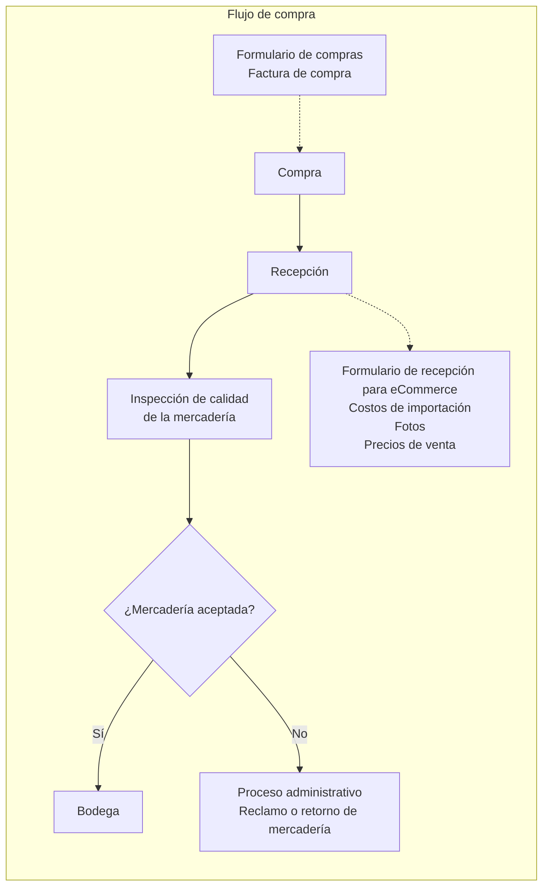
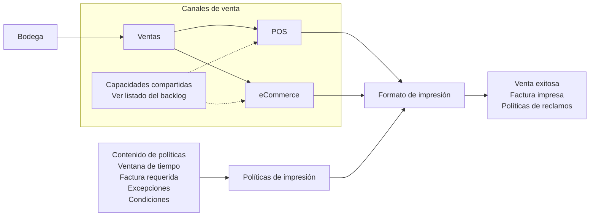
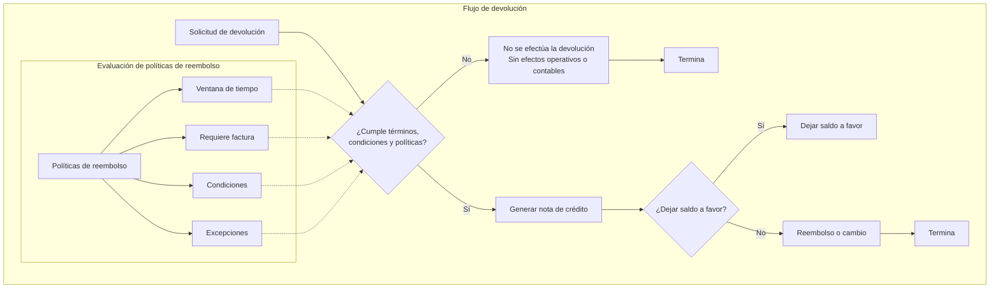

# POS · Diseño y backlog funcional

Diseño futuro de una aplicación POS que todavía no existe. Conserva los flujos de las imágenes proporcionadas por gerencia; no describe funciones implementadas ni procedimientos o políticas vigentes.

Este documento está fuera de los Wiki Spaces y no se incorpora a `.wiki.json`. Cuando exista el repositorio de la aplicación, trasladar allí el diseño y mantenerlo junto al código.

## Compras y recepción

El diseño contempla captura de la compra, recepción, preparación de información para eCommerce y control de calidad. Falta definir los documentos del sistema y los efectos sobre inventario y contabilidad; el diagrama no establece cuándo se registran esos efectos.

## Ventas POS y eCommerce

### Capacidades del diseño original

1. Factura.
2. Devoluciones.
3. Crear cliente desde POS.
4. Crear cliente y usuario para eCommerce.
5. Orden de venta y preventa.
6. Entrada de pago: recibo, salida e interno, según la terminología del diseño original.
7. Inventario disponible.
8. Cotizaciones.
9. Reglas de precio.
10. Órdenes de eCommerce.
11. Notas de entrega.
12. Solicitud de inventario.

Los nombres anteriores son capacidades funcionales propuestas, no asignaciones confirmadas a DocTypes. En particular, «recibo, salida e interno» requiere precisar los movimientos que representa.

La impresión forma parte del modelo original. Falta definir cuándo corresponde imprimir o entregar un comprobante digital, especialmente para eCommerce; no se asume impresión física obligatoria en todos los canales.

## Devoluciones, crédito y reembolso

La imagen original muestra los criterios de política conectados entre sí sin definir qué respuestas permiten continuar. Aquí se representan como entradas de la evaluación, sin inventar una secuencia de aprobación.

«Sin efectos operativos o contables» conserva la intención del rechazo en el diseño original; no decide si debe guardarse un registro de la solicitud y su resolución.

La nota de crédito y las opciones posteriores son el modelo propuesto. Debe validarse su tratamiento documental, contable y de inventario antes de implementarlo. Las políticas podrán variar por negocio; este diseño no reemplaza las políticas comerciales vigentes.

## Decisiones pendientes

- Alcance de la aplicación e integración con ERPNext y eCommerce.
- Documentos y efectos de cada operación de compra, recepción, venta y devolución.
- Relación entre información de recepción, fotos, costos de importación y precios de venta.
- Criterios y responsables del control de calidad y de los reclamos al proveedor.
- Reglas de autorización de devoluciones, cambios, créditos y reembolsos por negocio.
- Comportamiento y trazabilidad de solicitudes rechazadas.
- Significado de preventa, pagos internos, notas de entrega y solicitudes de inventario.
- Contenido de políticas que aparece en cada comprobante y modalidades de entrega del documento.
- Tratamiento del saldo a favor, reembolso y cambio, incluida la disponibilidad de inventario.

No se asignan prioridades, responsables ni fechas. Al desarrollar la aplicación, revisar estas decisiones antes de convertir los diagramas en comportamiento del sistema.
