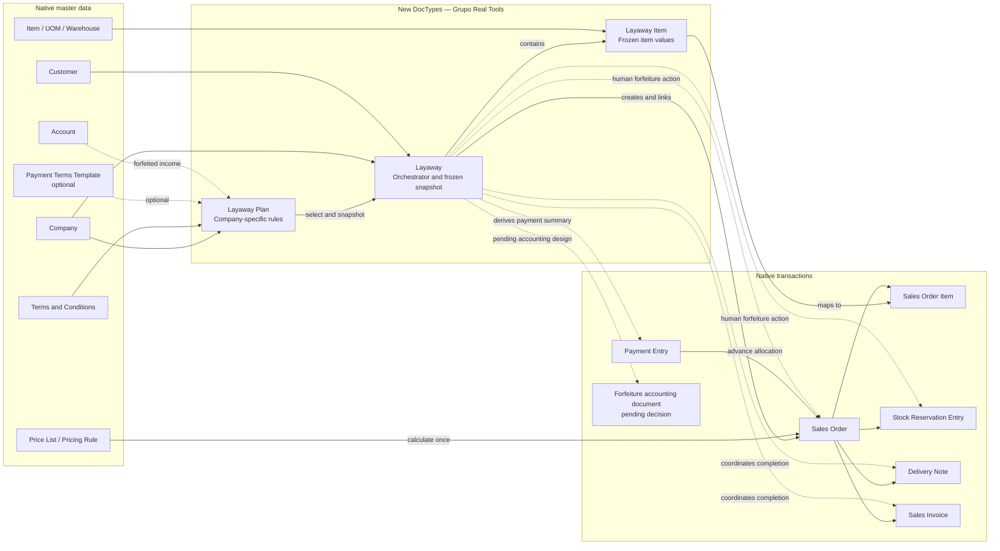
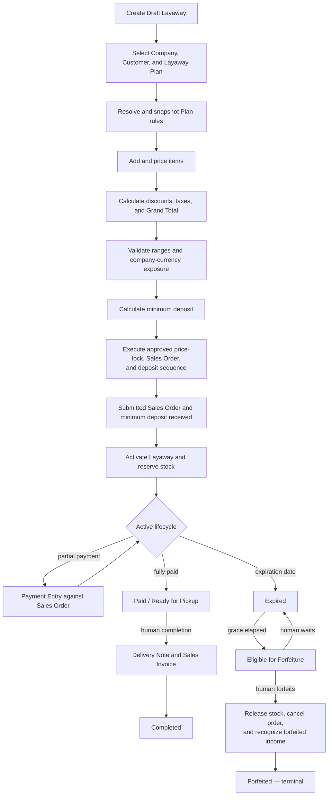

# Layaway

App overview: [Grupo Real Tools](../../README.md).
Development instructions: [AGENTS.md](AGENTS.md).

## Purpose and scope

The Layaway module is intended to manage merchandise reservations, deposits, partial payments, expiration, completion,
and forfeiture while preserving ERPNext as the authority for sales, payments, inventory, delivery, and accounting.

`Layaway` is the business orchestrator. It must link and coordinate standard ERPNext documents instead of reproducing
their ledgers or transactional behavior.

Development remains incremental. The approved design uses selectable `Layaway Plan` records rather than one global
`Layaway Settings` document, allowing each company to offer multiple plans such as 15-day, 30-day, or 45-day preorder
plans with different eligibility limits, deposit percentages, pricing behavior, and contractual terms.

## Implemented behavior

The current checkout contains a generated, submittable `Layaway` DocType scaffold with only its standard
`amended_from` field. Its controller contains no business logic, its JavaScript file contains only commented scaffold
code, and its integration test is empty.

No current implementation creates Sales Orders, receives or aggregates payments, reserves stock, evaluates customer
exposure, enforces plan rules, expires Layaways, completes delivery, or performs forfeiture accounting.

`Layaway Plan` and `Layaway Item` are approved design, not implemented DocTypes.

## Technical documentation

### Approved architecture

#### Custom DocTypes

| DocType        | Ownership                                                                                    |
|----------------|----------------------------------------------------------------------------------------------|
| `Layaway Plan` | Defines one company-specific commercial offer and its configurable rules.                    |
| `Layaway`      | Orchestrates one customer reservation and stores an immutable snapshot of the selected Plan. |
| `Layaway Item` | Stores the reserved item rows and their frozen commercial values.                            |

`Layaway Plan` is a regular DocType, not a Single. A company may offer several enabled Plans concurrently.

#### Native ERPNext DocTypes

| Native DocType                    | Layaway responsibility                                                                            |
|-----------------------------------|---------------------------------------------------------------------------------------------------|
| `Company`                         | Owns each Plan and provides company currency.                                                     |
| `Customer`                        | Owns the Layaway and is the subject of active-exposure limits.                                    |
| `Item`, `UOM`, `Warehouse`        | Provide item, quantity, unit, and physical-stock context.                                         |
| `Price List`, `Pricing Rule`      | Produce the commercial price before it is frozen.                                                 |
| `Terms and Conditions`            | Supplies the contractual text selected by the Plan and copied to the transaction.                 |
| `Payment Terms Template`          | Optionally supplies formal payment milestones; it is not required for arbitrary partial payments. |
| `Sales Order`, `Sales Order Item` | Remain the standard commercial transaction and item rows.                                         |
| `Payment Entry`                   | Records deposits and partial payments as advances against the Sales Order.                        |
| `Stock Reservation Entry`         | Reserves stock against submitted Sales Order items.                                               |
| `Delivery Note`, `Sales Invoice`  | Provide standard fulfillment and billing paths when a Layaway is completed.                       |
| `Account`                         | Identifies the company account configured for forfeited-deposit income.                           |

The exact accounting document used to recognize forfeited income remains pending accountant approval.



### Layaway Plan

A Plan represents a commercial offer, not a global application setting. The intended groups are listed below; exact
fieldnames and form layout must be created through Desk during the authorized structural phase.

#### Identity and availability

- Plan Name
- Company
- Enabled

Global rules such as 30 days, a 30% deposit, five active units, or a 300-unit monetary limit become values on a specific
Plan rather than hardcoded module behavior. Example Plans include `Standard 30 Days`, `Express 15 Days`, and
`Preorder 45 Days`.

#### Per-Layaway eligibility ranges

- Minimum Layaway Amount in company currency
- Maximum Layaway Amount in company currency
- Minimum Layaway Quantity
- Maximum Layaway Quantity

#### Per-customer active exposure

- Maximum Active Amount per Customer in company currency
- Maximum Active Quantity per Customer

Active exposure behaves like an operational reservation limit, not an ERPNext credit limit or accounting ledger. The
initial design calculates it from active Layaways instead of introducing a separate custom ledger DocType.

#### Pricing

- Pricing Rule Behavior: `Apply` or `Ignore`

ERPNext Price List behavior remains native. The Plan decides whether Pricing Rules participate in the initial price
calculation. Once the Layaway reaches its price-lock point, later Pricing Rule changes must not reprice it.

#### Timing and deposit

- Reservation Days
- Grace Period Days
- Minimum Deposit Percentage

The minimum deposit is calculated only after the final commercial total is known.

#### Terms and accounting configuration

- Terms and Conditions
- Payment Terms Template, optional
- Forfeited Deposit Income Account

The Plan intentionally has no Default Warehouse. Each Sales Order item must use its actual warehouse from the normal
ERPNext selling and stock context.

### Layaway snapshot

Each Layaway must retain both the selected Plan link and the values that governed the agreement. Editing a Plan must not
reinterpret existing Layaways.

The intended snapshot includes:

- Plan name and company;
- eligibility and customer-exposure limits;
- reservation and grace days;
- minimum deposit percentage and calculated amount;
- Pricing Rule behavior;
- Terms and Conditions link and rendered terms text;
- optional Payment Terms Template;
- transaction currency, company currency, and conversion rate;
- transaction and company-currency totals;
- item rates, discounts, amounts, quantities, UOMs, and warehouses.

### Pricing, discounts, and fixed price

Pricing is resolved before the deposit:

1. Select the Plan, Price List, and transaction currency.
2. Apply or ignore Pricing Rules according to the Plan.
3. Calculate item rates, discounts, taxes, and final Grand Total through ERPNext.
4. Validate Plan ranges and customer exposure using company-currency values.
5. Calculate the minimum deposit from the final Grand Total.
6. Freeze the Plan, pricing, discounts, totals, currency, and exchange-rate snapshot at the approved price-lock point.

The agreed price remains fixed throughout the active Layaway lifecycle. The exact event that locks the price—before or
after Sales Order submission and minimum-deposit receipt—remains an open workflow decision.

### Multi-currency and limits

A Layaway may use USD, NIO, or another valid ERPNext transaction currency. It must retain the normal ERPNext transaction
and company-currency values:

```text
grand_total
base_grand_total
minimum_deposit
base_minimum_deposit
conversion_rate
```

Plan amount ranges and customer active-amount limits are evaluated in company currency using base values. This allows
Layaways in different transaction currencies to consume one comparable company-specific limit.

Quantity limits refer to the sum of reserved `stock_qty`, not the number of item rows or distinct SKUs. Cross-UOM
comparability remains a pending decision for Plans that may include stock UOMs other than a common discrete unit such
as `Nos`.

### Payments and payment terms

Deposits and partial payments remain native `Payment Entry` documents allocated to the submitted Sales Order.
`Layaway` derives Paid Amount and Outstanding Amount from that approved reference path; it must not introduce a custom
payment child table or accounting ledger.

`Terms and Conditions` contains the contractual Layaway text. `Payment Terms Template` is optional and should be used
only when a Plan defines formal payment milestones. A flexible Layaway that accepts arbitrary partial payments does not
require a fixed installment schedule.

After a Layaway becomes `Forfeited`, no new payment may reference it or its dead Sales Order. Money received afterward
must be recorded as a separate customer advance for another purpose.

### Lifecycle model

Lifecycle, payment, and fulfillment represent different dimensions and must not be collapsed into one ambiguous status
field.

```text
Lifecycle Status:
Draft → Awaiting Deposit → Active → Completed
                           └──────→ Expired → Forfeited
Draft / Awaiting Deposit / Active / Expired → Cancelled

Payment Status, derived:
Unpaid → Partially Paid → Paid

Fulfillment Status, derived:
Unreserved → Reserved → Ready for Pickup → Delivered
                        └───────────────→ Released
```

Reaching the expiration date makes the Layaway overdue. The grace period determines when it becomes eligible for
forfeiture. Releasing stock, cancelling the Sales Order, and recognizing forfeited income require an explicit human
action; elapsed time alone must not perform those destructive operations.

`Forfeited`, `Completed`, and `Cancelled` are terminal lifecycle states.

### Intended operational flow



This flow is approved architectural direction, not implemented behavior. Steps that depend on pending decisions must be
resolved before their implementation phase.

### Development phases

#### Phase 1 — Structural foundation

Create and arrange the following through the Frappe DocType UI:

- `Layaway Plan`;
- `Layaway`;
- `Layaway Item`.

The forms must represent the intended architecture without transactional automation or rule enforcement.

#### Phase 2 — Native ERPNext links

Connect Layaway to Customer, Company, Item, Terms and Conditions, optional Payment Terms Template, Sales Order,
Payment Entry, and Stock Reservation Entry after ownership, retry, cancellation, and recovery rules are approved.

#### Phase 3 — Business behavior

Implement Plan resolution, eligibility, exposure, calculations, price locking, state transitions, expiration, grace,
completion, and forfeiture only after the relevant open decisions are resolved.

### Phase 1 form intent

The Layaway form should present an operational hierarchy:

```text
CUSTOMER + PLAN + LIFECYCLE STATUS + EXPIRATION

ITEMS

GRAND TOTAL          XXX
MINIMUM DEPOSIT      XXX
PAID AMOUNT          XXX
OUTSTANDING AMOUNT   XXX

PAYMENT HISTORY / RELATED DOCUMENTS

TERMS / COMPLETION / EXPIRATION / FORFEITURE AUDIT
```

The item table should reserve a place for Item, Item Name, Description, Quantity, Stock Quantity, UOM, Rate, Discount,
Amount, and Warehouse. Summary and audit fields may remain structural placeholders in Phase 1.

Payment history must be a visual location for related native Payment Entries, not a custom payment table.

### Phase 1 definition of done

Phase 1 is complete when:

- `Layaway Plan`, `Layaway`, and `Layaway Item` exist;
- both main forms have a clear operational layout;
- item rows can be entered;
- transaction and company-currency summary fields have intentional locations;
- deposit, expiration, grace, payment summary, terms, related documents, and audit information have intentional places;
- the DocTypes install or migrate correctly;
- structural tests pass;
- no Sales Order, Payment Entry, stock reservation, expiration, completion, or accounting automation has been added.

## Backlog

The following decisions remain open and do not authorize implementation:

- determine the exact price-lock event relative to Sales Order submission and minimum-deposit receipt;
- decide whether payments remain allowed after the grace period ends but before a human executes forfeiture;
- define whether a linked Payment Terms Template is enforceable or informational for Layaway;
- define cross-UOM behavior for quantity limits;
- approve the completion sequence between Delivery Note and Sales Invoice;
- obtain accounting approval for the forfeiture document, accounts, cancellation sequence, and treatment of received
  advances;
- decide whether the non-destructive transition to `Expired` is automatic or manual;
- define Plan availability controls such as default selection and effective dates if operationally required.
